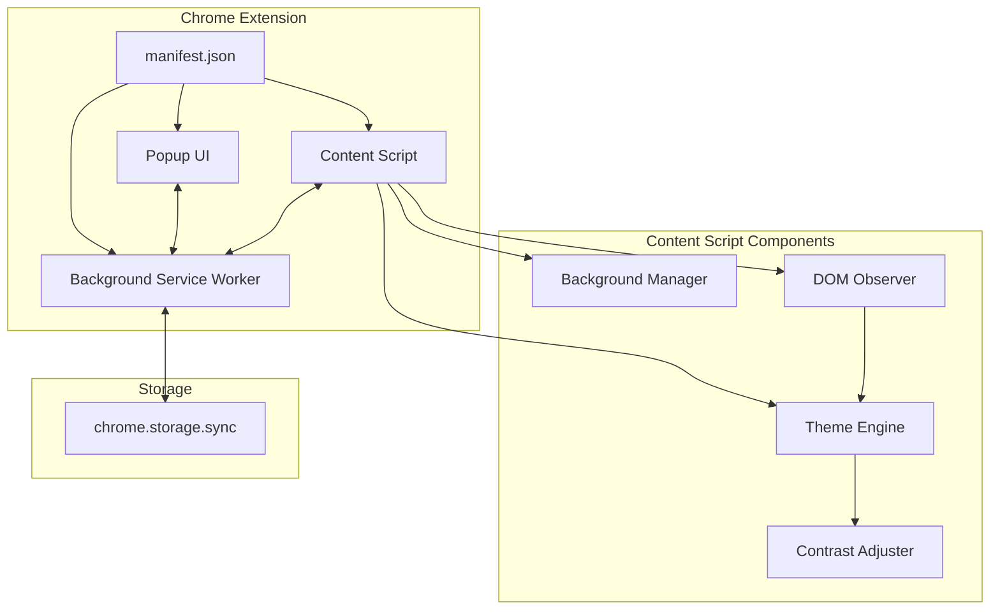

# Design Document

## Overview

The Sasuke Purple Theme Chrome Extension is a browser extension that transforms webpages into a purple-themed interface with a Sasuke Uchiha background image. The extension uses Chrome Extension Manifest V3 architecture with content scripts for DOM manipulation and a background service worker for state management.

The design follows a layered approach where the background Sasuke image sits at the lowest z-index, webpage content maintains its original structure in the middle layer, and CSS transformations apply purple theming while preserving text readability through dynamic contrast adjustment.

### Key Design Principles

1. **Non-destructive transformation**: All styling modifications are reversible
2. **Performance first**: CSS-based transformations to avoid layout recalculation overhead
3. **Readability preservation**: WCAG AA compliance through dynamic contrast adjustment
4. **Progressive enhancement**: Works on static pages first, then handles dynamic content

## Architecture

### High-Level Components



### Component Responsibilities

**Background Service Worker**
- Manages global extension state
- Handles browser action button clicks
- Stores and retrieves domain-specific preferences
- Communicates with content scripts via message passing

**Content Script**
- Injected into every webpage
- Applies purple theme transformations
- Manages background image layer
- Monitors DOM changes for dynamic content
- Adjusts text contrast dynamically

**Popup UI**
- Provides visual control interface
- Displays current theme state
- Triggers theme toggle actions

**Theme Engine**
- Core component that applies CSS transformations
- Maintains purple color palette
- Handles element-by-element styling
- Preserves original layout structure

**Contrast Adjuster**
- Analyzes text-background contrast ratios
- Applies corrective styling for WCAG AA compliance
- Manages text shadows and background overlays

**Background Manager**
- Creates fixed-position background layer
- Positions Sasuke image
- Ensures proper z-index stacking

**DOM Observer**
- Uses MutationObserver API to detect new elements
- Triggers theme application on dynamic content
- Throttles updates to prevent performance degradation

## Components and Interfaces

### Theme Engine

**Purpose**: Apply purple color transformations to webpage elements

**Public Interface**:
```javascript
class ThemeEngine {
  // Apply theme to entire document
  applyTheme(): void
  
  // Remove theme and restore original styling
  removeTheme(): void
  
  // Apply theme to specific element
  applyToElement(element: HTMLElement): void
  
  // Get purple shade for given color
  getPurpleShade(originalColor: string): string
}
```

**Color Palette**:
- Background shades: `#1a0033`, `#2d0052`, `#400070`, `#53008f`
- Foreground shades: `#6b00b8`, `#8b00e0`, `#a64dff`, `#c280ff`
- Accent colors: `#e0b3ff`, `#f0d9ff`

**Transformation Strategy**:
1. Extract computed styles for each element
2. Convert background colors to purple equivalents based on lightness
3. Convert text colors to maintain contrast
4. Apply transformations via inline styles or injected stylesheet
5. Store original styles in data attributes for reversal

### Contrast Adjuster

**Purpose**: Ensure WCAG AA compliance for text readability

**Public Interface**:
```javascript
class ContrastAdjuster {
  // Calculate contrast ratio between two colors
  calculateContrast(foreground: string, background: string): number
  
  // Adjust text color to meet minimum contrast ratio
  adjustTextColor(element: HTMLElement, minRatio: number): void
  
  // Apply text shadow or background for readability
  enhanceReadability(element: HTMLElement): void
  
  // Check if contrast meets WCAG AA standard
  meetsWCAG_AA(foreground: string, background: string): boolean
}
```

**Algorithm**:
1. Calculate relative luminance for foreground and background colors
2. Compute contrast ratio: `(L1 + 0.05) / (L2 + 0.05)` where L1 > L2
3. If ratio < 4.5, progressively lighten or darken text color
4. For cases where color adjustment insufficient, apply semi-transparent background or text shadow

### Background Manager

**Purpose**: Create and manage Sasuke background image layer

**Public Interface**:
```javascript
class BackgroundManager {
  // Create background layer with Sasuke image
  createBackgroundLayer(): void
  
  // Remove background layer
  removeBackgroundLayer(): void
  
  // Update background positioning
  updatePosition(): void
}
```

**Implementation Details**:
- Creates fixed-position div with `z-index: -1`
- Uses CSS `background-image` with Sasuke shadow image
- Applies `background-attachment: fixed` for scroll persistence
- Sets `pointer-events: none` to prevent interaction blocking
- Image format: SVG or PNG with transparency
- Dimensions: Full viewport coverage with `background-size: cover`

### State Manager

**Purpose**: Track and persist theme activation state

**Public Interface**:
```javascript
class StateManager {
  // Get theme state for current domain
  getState(domain: string): Promise<boolean>
  
  // Set theme state for current domain
  setState(domain: string, enabled: boolean): Promise<void>
  
  // Get global theme state
  getGlobalState(): Promise<boolean>
  
  // Toggle theme for current domain
  toggleState(domain: string): Promise<boolean>
}
```

**Storage Schema**:
```javascript
{
  "domainStates": {
    "example.com": true,
    "github.com": false
  },
  "globalEnabled": true
}
```

### DOM Observer

**Purpose**: Monitor DOM changes and apply theme to dynamic content

**Public Interface**:
```javascript
class DOMObserver {
  // Start observing DOM mutations
  start(): void
  
  // Stop observing
  stop(): void
  
  // Handle mutation callback
  onMutation(mutations: MutationRecord[]): void
}
```

**Configuration**:
- Observe childList, subtree, and attributes
- Throttle mutations to batch process every 200ms
- Filter out irrelevant mutations (style changes from theme itself)

## Data Models

### Theme State

```typescript
interface ThemeState {
  // Whether theme is currently active on this tab
  isActive: boolean
  
  // Domain of current page
  domain: string
  
  // Timestamp of last activation
  lastToggled: number
}
```

### Domain Preference

```typescript
interface DomainPreference {
  // Domain name
  domain: string
  
  // Whether theme should be active by default
  enabled: boolean
  
  // User override flag
  userSet: boolean
}
```

### Color Mapping

```typescript
interface ColorMapping {
  // Original color value
  original: string
  
  // Purple equivalent
  purple: string
  
  // Lightness value (0-100)
  lightness: number
}
```

### Extension Message

```typescript
interface ExtensionMessage {
  // Action type
  action: 'toggle' | 'getState' | 'setState'
  
  // Optional payload
  data?: any
  
  // Message ID for response matching
  messageId: string
}
```

## Correctness Properties

*A property is a characteristic or behavior that should hold true across all valid executions of a system—essentially, a formal statement about what the system should do. Properties serve as the bridge between human-readable specifications and machine-verifiable correctness guarantees.*


### Property Reflection

After analyzing all acceptance criteria, I identified the following testable properties:

**Testable as Properties:**
- 1.2, 1.3: Color conversion to purple (can be combined)
- 1.5: Layout preservation
- 2.4: Fixed background during scroll
- 2.5: Z-index ordering
- 3.1: WCAG AA contrast compliance
- 3.5: Link distinguishability
- 4.2: Toggle inversion
- 4.3: Icon state reflection
- 4.4: Theme removal restoration
- 4.5: State persistence
- 6.4, 6.5: Dynamic content styling (can be combined)

**Redundancies identified:**
1. Properties 1.2 and 1.3 both test color conversion to purple - can be combined into a single comprehensive property
2. Properties 3.2, 3.3, 3.6 are all mechanisms for achieving 3.1 (contrast compliance) - redundant
3. Property 3.4 duplicates 2.5 (z-index ordering) - redundant
4. Properties 6.4 and 6.5 both test dynamic content handling - can be combined

**Final Property Set (after removing redundancies):**
1. Color conversion to purple (combines 1.2, 1.3)
2. Layout preservation (1.5)
3. Fixed background positioning (2.4)
4. Z-index ordering (2.5)
5. WCAG AA contrast compliance (3.1)
6. Link distinguishability (3.5)
7. Toggle inversion (4.2)
8. Icon state reflection (4.3)
9. Theme removal restoration (4.4)
10. State persistence (4.5)
11. Dynamic content styling (6.4, 6.5)

### Property 1: Color Conversion to Purple

*For any* HTML element with background or foreground color styling, when the theme is applied, all color values should be converted to purple shades that maintain the relative lightness of the original colors.

**Validates: Requirements 1.2, 1.3**

### Property 2: Layout Preservation

*For any* HTML element, when the theme is applied, the element's layout properties (position, width, height, margin, padding, display type) should remain unchanged from their original values.

**Validates: Requirements 1.5**

### Property 3: Fixed Background Positioning

*For any* scroll position on a themed page, the Sasuke background image should remain in the same viewport-relative position (not scroll with content).

**Validates: Requirements 2.4**

### Property 4: Z-Index Ordering

*For any* webpage content element, when the theme is active, the element's effective z-index should be greater than the background layer's z-index, ensuring content remains visible above the Sasuke image.

**Validates: Requirements 2.5**

### Property 5: WCAG AA Contrast Compliance

*For any* text element on a themed page, the contrast ratio between the text color and its effective background color should be at least 4.5:1 for normal text and 3:1 for large text (18pt or 14pt bold).

**Validates: Requirements 3.1**

### Property 6: Link Distinguishability

*For any* link element (`<a>` tag) on a themed page, its visual styling (color, text-decoration, or other properties) should differ from non-link text elements, making links identifiable.

**Validates: Requirements 3.5**

### Property 7: Toggle Inversion

*For any* initial theme state (active or inactive) on a tab, toggling the theme should invert the state, and toggling again should return to the original state (toggle is an involution).

**Validates: Requirements 4.2**

### Property 8: Icon State Reflection

*For any* theme activation state (on or off), the browser action icon should visually reflect that state (different icon or badge for active vs inactive).

**Validates: Requirements 4.3**

### Property 9: Theme Removal Restoration

*For any* webpage, applying the theme and then removing it should restore all element styles to their original pre-theme values (round-trip property).

**Validates: Requirements 4.4**

### Property 10: State Persistence Round-Trip

*For any* domain and theme state value, storing the state to chrome.storage and then retrieving it should return the same state value that was stored.

**Validates: Requirements 4.5**

### Property 11: Dynamic Content Styling

*For any* HTML element added to the DOM after initial page load, if the theme is active, the element should receive purple theme styling consistent with statically present elements.

**Validates: Requirements 6.4, 6.5**

## Error Handling

### Content Script Errors

**Invalid DOM State**
- **Scenario**: Content script runs before DOM is ready
- **Handling**: Wait for DOMContentLoaded event before applying theme
- **Fallback**: Use MutationObserver to detect when body becomes available

**Missing Elements**
- **Scenario**: Expected elements (html, body) don't exist
- **Handling**: Validate document structure before applying theme
- **Recovery**: Retry theme application up to 3 times with exponential backoff

**Style Application Failures**
- **Scenario**: Unable to set inline styles due to CSP or other restrictions
- **Handling**: Fall back to injected stylesheet approach
- **User Feedback**: Log warning to console, theme may not apply fully

### Storage Errors

**Storage Quota Exceeded**
- **Scenario**: chrome.storage.sync quota exceeded
- **Handling**: Fall back to chrome.storage.local
- **User Feedback**: Show notification that settings may not sync across devices

**Storage Access Denied**
- **Scenario**: Permissions revoked or storage unavailable
- **Handling**: Use in-memory state as fallback
- **User Feedback**: Warn user that preferences won't persist

### Message Passing Errors

**Background Script Unavailable**
- **Scenario**: Service worker suspended or crashed
- **Handling**: Content script operates independently with local state
- **Recovery**: Retry message with exponential backoff (max 3 attempts)

**Message Timeout**
- **Scenario**: No response from background/content script within 5 seconds
- **Handling**: Proceed with cached state
- **User Feedback**: Show "Unable to sync state" message

### Browser Compatibility Errors

**Unsupported APIs**
- **Scenario**: Running on older Chrome version
- **Handling**: Feature detection for all Chrome APIs used
- **Fallback**: Gracefully degrade (e.g., skip storage sync if unavailable)

**Protected Pages**
- **Scenario**: Extension cannot inject into chrome://, chrome-extension://, etc.
- **Handling**: Detect protected URLs and skip injection
- **User Feedback**: Gray out browser action button on protected pages

## Testing Strategy

### Dual Testing Approach

This extension requires both unit tests and property-based tests to ensure correctness:

**Unit Tests** verify:
- Specific configuration examples (manifest structure, icon files exist)
- Edge cases (empty pages, pages with no text, CSP-restricted pages)
- Error conditions (storage failures, message timeouts)
- Integration points (content script injection, message passing)
- Concrete examples of theme application

**Property-Based Tests** verify:
- Universal properties across all inputs (color conversion, contrast ratios, layout preservation)
- Round-trip properties (theme apply/remove, state storage/retrieval)
- Invariants (z-index ordering, toggle inversion)
- Dynamic behavior across randomly generated elements

Together, these approaches provide comprehensive coverage where unit tests catch concrete bugs and property tests verify general correctness across the input space.

### Property-Based Testing Configuration

**Library**: fast-check (JavaScript/TypeScript property-based testing library)

**Configuration**:
- Each property test runs minimum 100 iterations
- Tests generate random HTML elements with varying styles
- Color values generated across full RGB spectrum
- DOM structures generated with varying nesting depths (1-10 levels)

**Test Tagging**:
Each property test includes a comment tag referencing the design property:
```javascript
// Feature: sasuke-purple-theme-extension, Property 1: Color Conversion to Purple
```

### Unit Testing Strategy

**Framework**: Jest with Chrome extension mocking

**Test Coverage Areas**:

1. **Theme Engine Unit Tests**
   - Test color conversion with specific color values
   - Test purple palette selection based on lightness
   - Test style application to individual elements
   - Edge case: elements with no background color
   - Edge case: elements with transparent backgrounds

2. **Contrast Adjuster Unit Tests**
   - Test contrast calculation algorithm with known color pairs
   - Test WCAG AA threshold detection (4.5:1)
   - Test color adjustment algorithm
   - Edge case: pure black/white combinations
   - Edge case: colors already meeting contrast requirements

3. **Background Manager Unit Tests**
   - Test background layer creation
   - Test CSS properties (position: fixed, z-index, pointer-events)
   - Test background layer removal
   - Edge case: calling createBackgroundLayer twice

4. **State Manager Unit Tests**
   - Test state storage and retrieval
   - Test domain-based state management
   - Test toggle behavior
   - Mock chrome.storage.sync API
   - Error case: storage quota exceeded
   - Error case: storage access denied

5. **DOM Observer Unit Tests**
   - Test mutation detection
   - Test throttling behavior (200ms batching)
   - Test filtering of self-generated mutations
   - Edge case: rapid DOM changes (100+ elements/second)

6. **Message Passing Unit Tests**
   - Test background-content communication
   - Test message timeout handling
   - Test message ID matching for responses
   - Error case: background script unavailable

7. **Manifest Validation Tests**
   - Verify manifest.json is valid JSON
   - Verify Manifest V3 required fields present
   - Verify permissions include "activeTab", "storage"
   - Verify icon files exist at specified paths (16x16, 48x48, 128x128)

8. **Integration Tests**
   - Test extension loading on HTTP page
   - Test extension loading on HTTPS page
   - Test theme application on sample webpage
   - Test toggle from popup UI
   - Edge case: protected pages (chrome://, chrome-extension://)

### Property-Based Test Implementation

**Test Structure**:
Each correctness property from the design maps to exactly one property-based test:

```javascript
// Feature: sasuke-purple-theme-extension, Property 5: WCAG AA Contrast Compliance
test('property: WCAG AA contrast compliance', () => {
  fc.assert(
    fc.property(
      arbitraryElement(), // generates random HTML elements
      (element) => {
        themeEngine.applyToElement(element);
        const textColor = getComputedStyle(element).color;
        const bgColor = getEffectiveBackground(element);
        const contrast = contrastAdjuster.calculateContrast(textColor, bgColor);
        const fontSize = parseInt(getComputedStyle(element).fontSize);
        const fontWeight = getComputedStyle(element).fontWeight;
        
        // Large text: 18pt or 14pt bold
        const isLargeText = fontSize >= 18 || (fontSize >= 14 && fontWeight >= 700);
        const minRatio = isLargeText ? 3.0 : 4.5;
        
        expect(contrast).toBeGreaterThanOrEqual(minRatio);
      }
    ),
    { numRuns: 100 }
  );
});
```

**Arbitrary Generators**:
Custom generators for test data:
- `arbitraryElement()`: Generates HTML elements with random tags, styles, text content
- `arbitraryColor()`: Generates random RGB/RGBA/HSL color values
- `arbitraryDOMTree()`: Generates nested DOM structures
- `arbitraryScrollPosition()`: Generates random scroll coordinates

### Test Execution

**Local Development**:
```bash
npm test                    # Run all tests
npm test:unit              # Unit tests only
npm test:property          # Property-based tests only
npm test:coverage          # With coverage report
```

**CI/CD Pipeline**:
- Run full test suite on every commit
- Require 80% code coverage minimum
- Run tests in headless Chrome environment
- Generate test report artifacts

### Manual Testing Checklist

Due to the visual nature of the extension, manual testing is required for:
- [ ] Sasuke image displays correctly with visible eyes
- [ ] Purple theme looks aesthetically pleasing
- [ ] Text remains readable on real websites (test on 5+ popular sites)
- [ ] Background image blends well with theme
- [ ] Toggle button provides clear visual feedback
- [ ] Extension icon shows correct state in toolbar
- [ ] Performance remains smooth during scrolling
- [ ] No visual glitches during page load

